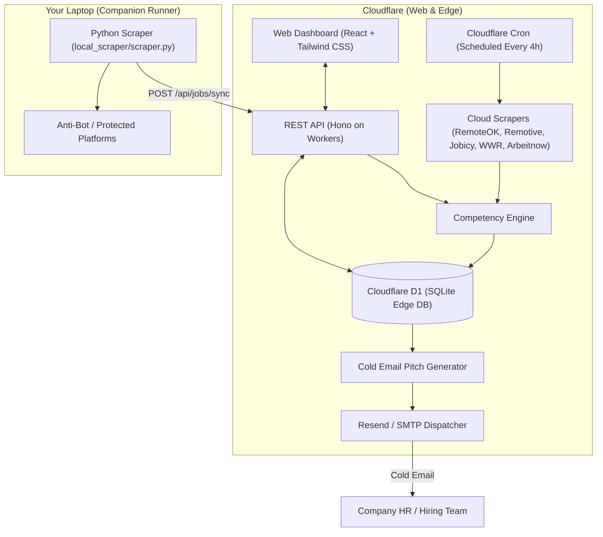

# Opportunity Hunter 🎯
> **Autonomous Remote & Part-Time IT Job Scraper and Cold Email Dispatcher**  
> Custom-tailored for **M Rizki Masjahri Putra** (PHP/Laravel, React/Next.js/Remix, Vue, Node.js, Tech Lead).

---

## 🌟 Highlights

- **Tailored Filtering**: Exclusively targets **Remote / WFH** and **Part-Time / Flexible Contract** roles.
- **Smart Competency Matcher**: Evaluates job descriptions against Rizki's primary tech stacks (Laravel, PHP, React, Vue, Node.js, TypeScript, Python FastAPI) and assigns a 0–100% Match Score with itemized match reasons.
- **HR Email Finder**: Automatically scans job posts and company profiles to extract hiring contacts (`jobs@`, `careers@`, `talent@`, `hr@`).
- **High-Conversion Cold Email Pitch**: Generates customized outreach pitches mentioning his 6+ years experience, international team leadership (Australia, Netherlands, UK, Singapore), and live portfolio showcases ([Kaya App](https://kaya-app.netlify.app/), [DeskTeam](https://deskteam-html-test.netlify.app/), [Seakom](https://seakom.netlify.app/en/home)).
- **Cloudflare 100% Free Tier**:
  - Hosted on **Cloudflare Workers** with Static Assets.
  - Edge database powered by **Cloudflare D1** (SQLite at the edge).
  - 24/7 background scheduler via **Cloudflare Cron Triggers** (`0 */4 * * *`).
- **Laptop Companion Runner**: Standalone Python script to scrape heavier anti-bot platforms (LinkedIn, Greenhouse, Lever) using your residential laptop IP, syncing directly to your Cloudflare web app.
- **Outreach Options**:
  - **1-Click Review & Pitch**: Inspect the opportunity, customize the pitch or recipient, and send.
  - **Autonomous Auto-Pilot**: Automatically dispatch cold emails if Match Score &ge; 85% with built-in daily safety limits (default max 15/day).

---

## 🏗️ System Architecture



---

## ⚡ Quick Start (Local Development)

### 1. Install Dependencies
```bash
npm install
```

### 2. Initialize Local D1 SQLite Database
```bash
npm run db:init
```

### 3. Build & Run Local Server
```bash
npm run build
npm run dev
```
Open **[http://localhost:8787](http://localhost:8787)** in your browser.

---

## 💻 Running the Laptop Companion Scraper

When you want to run heavy scrapers from your laptop that bypass bot blocks:

```bash
# 1. Install python dependencies
pip install -r local_scraper/requirements.txt

# 2. Run companion scraper and sync to your local app
python local_scraper/scraper.py --api-url http://localhost:8787 --token opp-hunter-secret-token

# 3. Or sync to your deployed Cloudflare Worker
python local_scraper/scraper.py --api-url https://opportunity-hunter.<your-subdomain>.workers.dev --token opp-hunter-secret-token
```

---

## ☁️ Deploying to Cloudflare (Free Tier)

### Step 1: Login to Cloudflare Wrangler
```bash
npx wrangler login
```

### Step 2: Create Remote Cloudflare D1 Database
```bash
npx wrangler d1 create opportunity-db
```
Wrangler will output something like:
```toml
[[d1_databases]]
binding = "DB"
database_name = "opportunity-db"
database_id = "xxxxxxxx-xxxx-xxxx-xxxx-xxxxxxxxxxxx"
```
Copy that `database_id` and replace the placeholder in your [wrangler.toml](file:///d:/MAINAN/opportunity/wrangler.toml#L12).

### Step 3: Run Migrations on Remote D1
```bash
npm run db:init:remote
```

### Step 4: Deploy Worker & Dashboard Assets
```bash
npm run deploy
```
Wrangler will build the React frontend and deploy both the static assets and the Hono API Worker to your free `*.workers.dev` subdomain!

---

## ✉️ Setting Up Free Email Sending (Resend)

1. Sign up for a free account at [resend.com](https://resend.com) (provides 100 free emails/day or 3,000/month).
2. Generate an API Key under **API Keys**.
3. In your Opportunity Hunter dashboard, click **Settings**:
   - Paste your **Resend API Key** (`re_...`).
   - Set your sender email (e.g., `onboarding@resend.dev` for testing, or your verified domain).
   - Click **Save Settings**.
4. You can also configure environment variables in Cloudflare dashboard or `wrangler.toml`:
   ```bash
   npx wrangler secret put RESEND_API_KEY
   ```

---

## 📁 Project Structure

```
opportunity/
├── src/
│   ├── index.ts               # Hono backend API + Worker entrypoint & Cron handler
│   ├── types.ts               # Shared TypeScript schemas
│   ├── services/
│   │   ├── matcher.ts         # Competency matching & part-time remote scoring
│   │   ├── hr-finder.ts       # HR email extractor & heuristic fallbacks
│   │   ├── email-generator.ts # Customized pitch generator featuring Rizki's CV & portfolio
│   │   ├── mailer.ts          # Resend API integration
│   │   └── scrapers/          # Cloud scrapers (RemoteOK, Remotive, Jobicy, WWR, Arbeitnow)
│   └── client/                # React 18 + Tailwind CSS + Lucide Dashboard
│       ├── App.tsx
│       ├── main.tsx
│       ├── index.css
│       ├── api.ts
│       └── components/        # Header, StatsBar, FilterBar, JobCard, EmailModal, SettingsModal, etc.
├── local_scraper/             # Python companion runner for your laptop
│   ├── requirements.txt
│   ├── scraper.py
│   └── README.md
├── schema.sql                 # D1 database schema & default profile seed
├── wrangler.toml              # Cloudflare configuration with D1 & Cron trigger
├── vite.config.ts             # Vite build configuration
└── package.json
```

---

## 📄 License
MIT. Built specifically for **M Rizki Masjahri Putra**.
